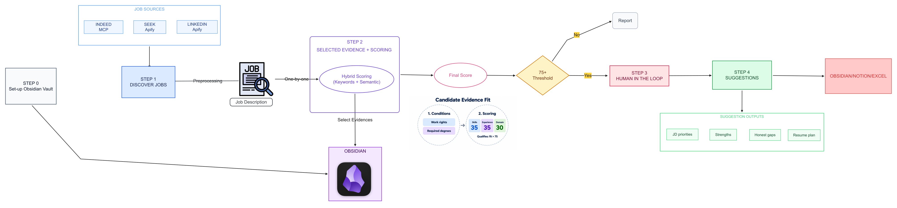

# Job Search

The job-search router coordinates three stage skills:

- **job-retrieval** discovers configured jobs and returns private jobs/coverage.
- **job-scoring** assesses saved jobs and ends at the ranked scoring report.
- **job-suggestions** generates detailed suggestions only for human-selected jobs.

A requested full job search (“get fresh jobs”, for example) runs discovery →
conditions and evidence scoring → a ranked numbered report → your selection →
selected-job suggestions → approved destination writes.
Ordinary conversation does not execute the pipeline. Explicit retrieval-only,
skill-only and saved-job scoring requests retain their requested scope.
`AGENTS.md` owns routing and shared protections; each skill owns its stage.
Reference documents provide definitions and connector facts.

## Workflow overview



The workflow produces recommendations and, after separate approval, application
records. It never submits applications or contacts employers.

## Setup and invocation

### Requirements

- macOS or Linux. On Windows, use WSL2; the launcher uses Bash and POSIX file
  locking.
- Python 3.10 or newer and Git.
- For terminal runs, install and sign in to the
  [Codex CLI](https://developers.openai.com/codex/cli/). The launcher looks for
  it at `/opt/homebrew/bin/codex` by default; set `CODEX_BIN` if it is elsewhere.
- Poppler's `pdftotext` for scoring nonempty job lists. Retrieval-only runs do
  not need PDF tools.
- For fresh discovery, configure the Indeed connector and Apify MCP tools in
  the Codex environment. The [source reference](.agents/skills/job-retrieval/references/sources.md)
  lists the expected providers and current actor details.

### Install the local dependencies

Clone the repository, replace the placeholder with its Git URL, and enter the
checkout:

```bash
git clone <repository-url>
cd Job-Search
```

Then install from the repository root:

```bash
python3 -m venv .venv
./.venv/bin/python -m pip install --upgrade pip
./.venv/bin/python -m pip install -r requirements.txt
mkdir -p resumes
```

Install Poppler if it is not already available:

```bash
# macOS
brew install poppler

# Debian, Ubuntu, or WSL2
sudo apt-get update
sudo apt-get install poppler-utils
```

If `pdftotext` is outside `PATH`, set `PDFTOTEXT_BIN` to its full path before
running the launcher.

### Add your own career data and provider settings

1. Add your career history, target roles, work authorization and evidence to
   `career-vault/`. Start with the templates in `career-vault/00 System/Templates/`
   and follow [the vault rules](career-vault/AGENTS.md). Only verified,
   source-linked notes are used as evidence.
2. Put at least two text-extractable PDF resumes in `resumes/` for scoring.
   This directory is local input; the PDFs are ignored by Git.
3. Set the roles, locations, enabled providers and `hybrid_search` option in
   `config/search_targets.yaml`.
4. Create a private `.env` file in the repository root for credentials. Set
   `APIFY_TOKEN` when LinkedIn or Seek is enabled. When `hybrid_search: true`,
   install the optional packages and provide `OPENAI_API_KEY` and
   `CHROMA_API_KEY`; set `CHROMA_TENANT` and `CHROMA_DATABASE` if your Chroma
   Cloud account requires them:

   ```bash
   ./.venv/bin/python -m pip install -r requirements-semantic.txt
   ```

   Hybrid search sends eligible verified evidence sections and job requirement
   text to OpenAI for embeddings, then stores vectors and citation metadata in
   Chroma Cloud. Read [the vault rules](career-vault/AGENTS.md) before enabling
   it. Set `hybrid_search: false` to use local keyword matching without OpenAI
   or Chroma credentials. `.env` is ignored by Git; never commit credentials.

This repository contains private career-vault notes, and Git tracks files under
`career-vault/`. Do not publish this checkout or its history publicly. To create
a public template, start from a sanitized copy with a fresh Git history and
review all files before committing. `.env`, resume PDFs, `.state/`, `reports/`
and `logs/` are ignored, but `career-vault/` is not.

### Check and run

The default readiness check prepares scoring inputs, including the resume PDFs
and `pdftotext`. To check discovery readiness instead, add
`--retrieval-only --check`.

```bash
./scripts/run.sh --check
./scripts/run.sh
./scripts/run.sh --lookback-hours 48
./scripts/run.sh --retrieval-only
./scripts/run.sh --scoring-only --input path/to/saved-jobs.json
```

`--check` validates local readiness only; it does not test connector sign-in,
provider access or hybrid cloud credentials, and it does not start a search.

If `codex` is installed in a non-default location, export its path before a
terminal run:

```bash
export CODEX_BIN="$(command -v codex)"
./scripts/run.sh
```

The full command can incur Apify charges within the configured run allowance.
The launcher saves its private run report under `reports/`. For a desktop Codex
run, open this repository as a local project and request the job-search skill;
native tasks invoke the skills directly and do not use `scripts/run.sh`.

Lookback resolution is user override, configuration, then default 24 hours.
Full searches alternate bounded Seek, LinkedIn and Indeed batches with scoring.
Default stops are five eligible jobs, 100 assessments or a USD 0.50 Apify retrieval
allowance. New acquisitions use submission-relative freshness windows and supported date
filters (Seek uses a day filter plus exact local validation); legacy
retrieval-only checkpoints keep their original fixed windows. Unsupported source windows,
result caps and incomplete coverage are visible. Discovery supervision defaults
to 30 minutes; its deadline saves partial coverage without restarting Actors.
Actor continuation is currently unsupported: capped queries are reported as
noncontinuable rather than scraped repeatedly. Posting-time uncertainty stays
visible. Configure optional `progressive_search` limits in search_targets.yaml;
reusing downloaded results avoids repeat calls, while local deduplication alone
cannot refund result charges. Evidence embedding and agent usage are separate
from the Apify allowance. Paid progressive acquisitions use the Apify REST
`maxTotalChargeUsd` run cap, refreshed pricing contracts and conservative event
reservations. The skill refreshes `.state/apify-charge-contracts.json` before a
new session; unknown submissions remain blocked. Websift Seek results include full descriptions; optional salary estimation is
disabled. Historical Bovi runs retain their page-inspection fallback.
Complete zero results succeed. Scoring reads one job per inspect page by default,
with at most three jobs per submission; full responses remain private.

Keyword-only mode needs no OpenAI/Chroma packages or keys. Hybrid mode adds
`requirements-semantic.txt` and the existing embedding/vector credentials;
unchanged inputs reuse their vectors. No generation API fallback is used.
Configured Indeed and Apify connectors provide job discovery; Apify launcher
credentials are loaded as data from the environment or private `.env`. Saved-job
scoring needs no source credentials.

Initial runs create no application records, resumes or cover letters. Current
report approval permits only named candidates at enabled destinations after
repeat checks. Source resumes stay immutable and letters need separate approval.

## Future scheduled runs

A native scheduled Codex task runs directly in this local project. Example prompt:

> Run the full job-search workflow for the latest 24 hours using AGENTS.md and
> the job-search router. Continue to the numbered candidate report and wait for my
> selection. Preserve partial coverage and report concrete blockers.

Use Australia/Melbourne time when creating a morning schedule after an explicit
request. This change creates no schedule and assumes no morning execution time.
The machine and desktop app must be running, with project files and connectors
available. Native tasks invoke the skills directly; `scripts/run.sh` launches a
CLI agent for terminal runs and must not be nested inside a native task.
Scheduled execution supplies no approval for destination writes.

## Project map

See [the scripts map](scripts/README.md) for entry points and internal modules.

| Area | Responsibility |
| --- | --- |
| `.agents/skills/job-search/` | Progressive coordination, retrieval budget and aggregate report. |
| `.agents/skills/job-retrieval/` | Complete discovery procedure. |
| `.agents/skills/job-scoring/` | Assessment and ranked reporting. |
| `.agents/skills/job-suggestions/` | Selection validation and approved-only suggestions. |
| `scripts/readiness.py` | Shared private readiness cache and invalidation. |
| `.agents/skills/job-retrieval/scripts/discovery.py`, `.agents/skills/job-retrieval/scripts/discovery_bridge.js` | Supervised configured-source checkpoints and recovery. |
| `.agents/skills/job-scoring/scripts/assessment.py` | Private assessment, resumable judgments and ranked scoring reports. |
| `.agents/skills/job-scoring/scripts/scoring.py` | Internal validated score arithmetic. |
| `.agents/skills/job-retrieval/references/sources.md`, `.agents/skills/job-scoring/references/scoring.md` | Connector and score definitions. |
| `docs/approved-destination-writes.md`, `docs/application-package-reference.md` | Separately approved preparation. |

## Maintaining sources

The separate ATS/government verifier uses optional `requirements-sources.txt`.
See `docs/additional-source-adapters.md`; those sources are not silently added to discovery.
Private state/reports/logs and career evidence remain preserved. CLI completed-turn
usage has separate full-turn scope; unavailable native usage remains null.

Implementation checks use saved fixtures. Necessary live acceptance is limited
to one platform/pair, max three results, with no automatic repeat or full paid
benchmark crawl. Historical specifications and verification notes describe their
original implementations; current skills and helpers define the active workflow.

## Skill resource ownership

Stage-specific executables and references live inside their skill's scripts/ and
references/ directories. Shared readiness, evidence, provenance, private I/O and
logging utilities remain in the repository scripts/ directory. Destination
procedures stay in docs/ because AGENTS.md coordinates them after suggestions;
optional source-adapter documentation also remains there for manual maintenance.

Human selection is validated with:

```bash
./.venv/bin/python .agents/skills/job-suggestions/scripts/approved_preparation.py select --run HANDLE --report-id REPORT_ID --numbers 1 2
```

The returned preparation handle is used by job-suggestions. This command saves
only private selected-job state, not destination records. Scheduling still ends
at the scoring report and cannot implicitly select jobs.
